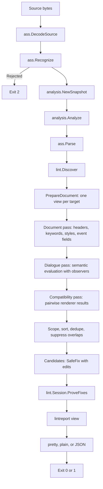
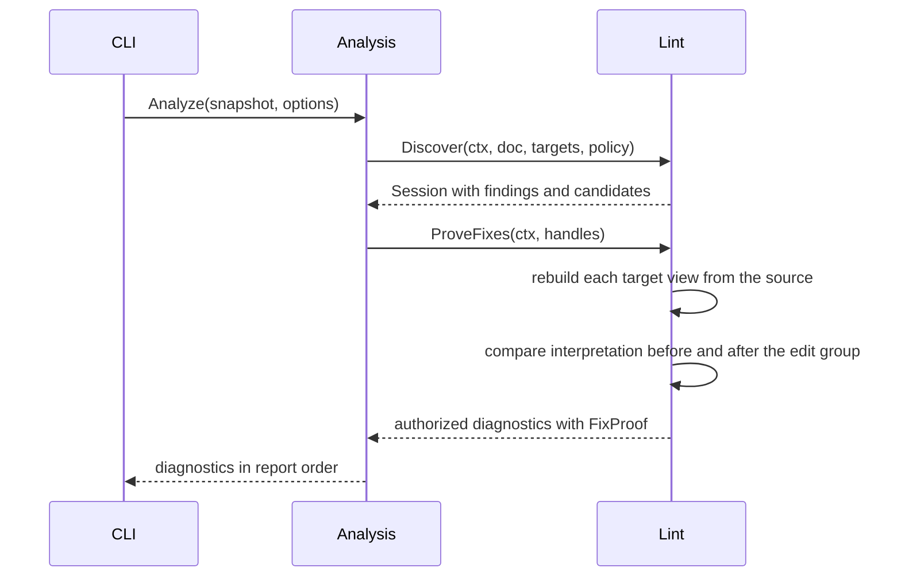
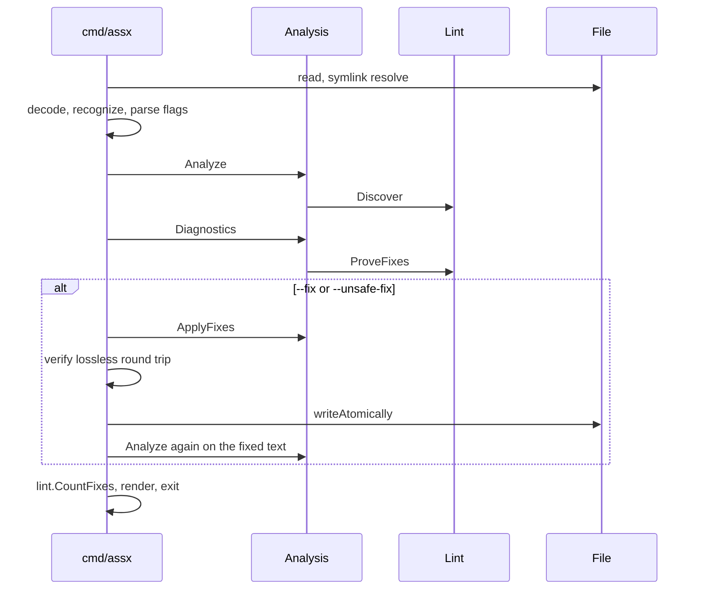
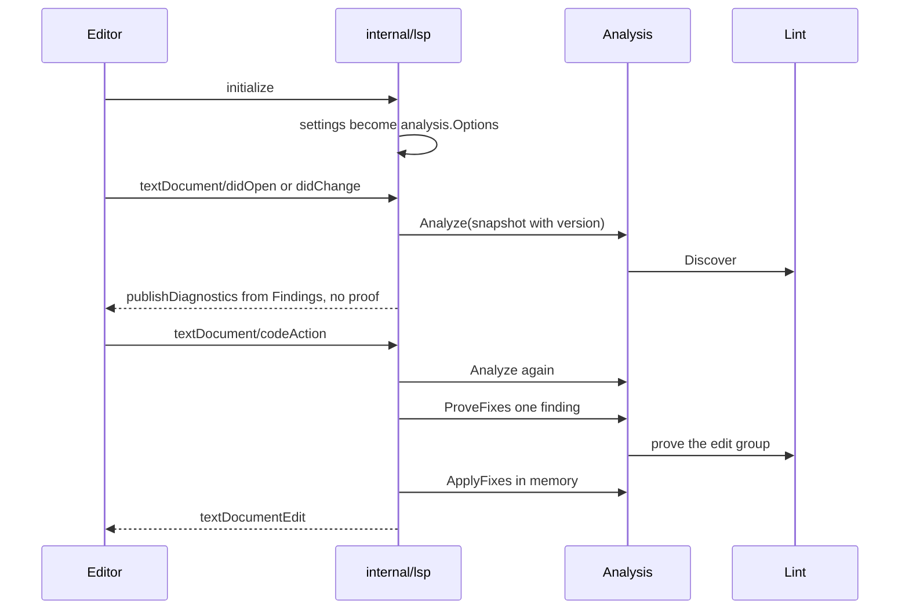

# Lint pipeline

This page states how one lint run moves from source bytes to reported
diagnostics. The package pages define the API of each stage.

## Layers

| Layer | Package | Job |
| --- | --- | --- |
| Source | `internal/ass` | Decode, recognize input, parse the concrete tree, keep spans |
| Dispatch | `internal/ass/spec`, `internal/ass/renderer` | Select a profile, project the document, resolve tag signatures |
| Evaluation | `internal/semantic` | Evaluate effective state, notify observers, compare renderers |
| Policy | `internal/lint` | Apply rule policy, group edit candidates, prove fixes |
| Orchestration | `internal/analysis` | Own the snapshot, the options, and the deferred proof |
| Presentation | `internal/lintreport`, `internal/report` | Render pretty, plain, or JSON output and set the exit code |

A lower layer never imports a higher layer. `internal/lint` uses `internal/ass`
and `internal/semantic`; it does not own parser or state logic.

## One run

`lint.Discover` records candidates and never builds a proof. It prepares the
document once, so validation, compatibility, and the redundant-Style collector
share one projected view and one resolved expression per profile.

## Deferred proof

The split exists because proof is expensive and most runs never apply an edit.

A `SafeFix` label without a proof carries no edits. A finding that fails proof
keeps its observation and loses the fix. `--unsafe-fix` adds the unsafe class;
it does not bypass proof.

## CLI path

The CLI refuses a write when the file does not round-trip byte for byte. A
`Tentative` recognition result permits analysis and blocks every write.

## Editor path

The language server uses the same orchestration with a different proof point.

The diagnostic `Data` field holds `identity:ordinal`. The server accepts a code
action only when the client sends back that identity, the rule ID, and the
range. A stale or foreign identity yields no action.

## Invariants

- One profile produces one projected view. A renderer-scoped pass strips fixes.
- A location may carry different rules, but an identical observation appears once.
- Output order is by line, then column, in every format.
- SafeFix requires one proof for the complete edit group across every target.
- Equal modeled state does not prove equal frames. `tools/rendercheck` checks frames.
