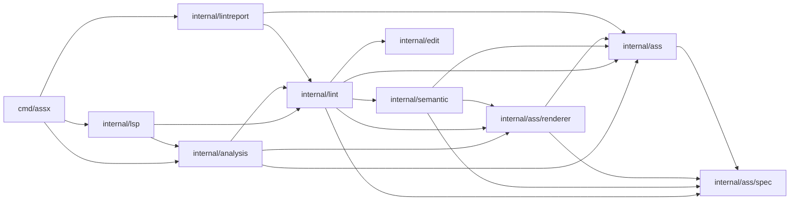
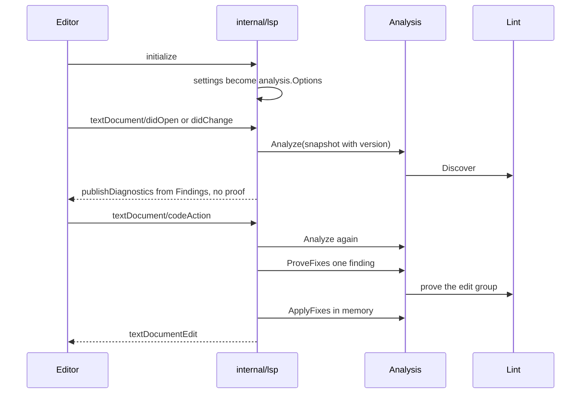

# Lint pipeline

This page states the layer structure, the data that moves between the layers,
and the state that authorizes an edit. The package pages define each API.

## Layer dependencies

An arrow means "imports". The graph has no cycle.

Additional edges: `internal/sourcepos` imports `internal/edit`;
`internal/lintreport` and `internal/report/pretty` import `internal/report`;
`internal/fontcheck` imports `internal/ass`, `internal/ass/renderer`, and
`internal/semantic`; `internal/fontreport` imports `internal/fontcheck` and
`internal/report`.

## Data flow

Each edge names the value that the next stage consumes.

```mermaid
flowchart LR
  B["file bytes"] --> D["ass.DecodeSource → Source"]
  D --> R["ass.Recognize → Classification"]
  R --> S["analysis.Snapshot"]
  S --> P["ass.Parse → ass.Document"]
  P --> PREP["lint.PrepareDocument → one view per target"]
  PREP --> DISC["lint.Discover → lint.Session"]
  DISC --> V["primary profile pass: document checks → []Diagnostic"]
  V --> DIA["per dialogue: semantic.PrepareDialogue, EachOperation → []Diagnostic"]
  DIA --> PORT["portability pass → []Diagnostic"]
  PORT --> COMP["compatibility pass: semantic.CompareDocument → []Diagnostic"]
  COMP --> ASM["assemble: merge observations, derive severity"]
  ASM --> SCOPE["sort, dedupe"]
  SCOPE --> CAND["candidates: SafeFix with edits"]
  CAND --> PROOF["ProveFixes → []Diagnostic with FixProof"]
  PROOF --> VIEW["lintreport view"]
  VIEW --> OUT["pretty, plain, JSON, exit code"]
```

`lint.Discover` records candidates and never builds a proof. It prepares the
document once, so validation, compatibility, and the redundant-Style collector
share one projected view and one resolved expression per profile.

## State and ownership

| State | Owner | Valid while | Invalidated by |
| --- | --- | --- | --- |
| `Snapshot` (URI, UTF-8 text, version) | `analysis.Result` | one analysis | different text |
| `Options` (targets, rule policy) | caller, copied into the result | one run | different target or policy |
| `Session` (id, document, targets, policy, findings, candidates, proof batch) | `lint`, held by `analysis.Result` | the source that `Discover` parsed | another source |
| `CandidateID` (session id, ordinal) | `Session` | that session | another session, stale or foreign handle |
| `FixProof` (source digest, edit ranges, per-target interpretation) | diagnostic, shared by a numbered group | the current source and the complete edit group | any edit, target change, or foreign source |
| `FindingID` (result id, ordinal) | `analysis.Result` | that result | a newer analysis |

A `SafeFix` label without a proof carries no edits and never authorizes a
write. A finding that fails proof keeps its observation and loses the fix.

## Editor path

The language server uses the same orchestration and proves at the code action,
not at the publish.

The diagnostic `Data` field holds `identity:ordinal`. The identity is the
document version and the settings generation. The server accepts a code action
only when the client returns that identity, the condition, and the range. A stale
or foreign identity yields no action.

## Invariants

| Invariant | Where it holds |
| --- | --- |
| One profile produces one projected view | `PrepareDocument`, `profile.DocumentView` |
| A renderer-scoped pass strips fixes | `scopeDiagnostics` |
| A location carries each condition once, with merged observations | `assemble` |
| Output order is line, then column | stable sort after the passes |
| SafeFix requires one proof for the complete edit group across every target | `ProveFixes` batch |
| A file that does not round-trip byte for byte is not written | CLI write guard |
| Equal modeled state does not prove equal frames | `tools/rendercheck` |
